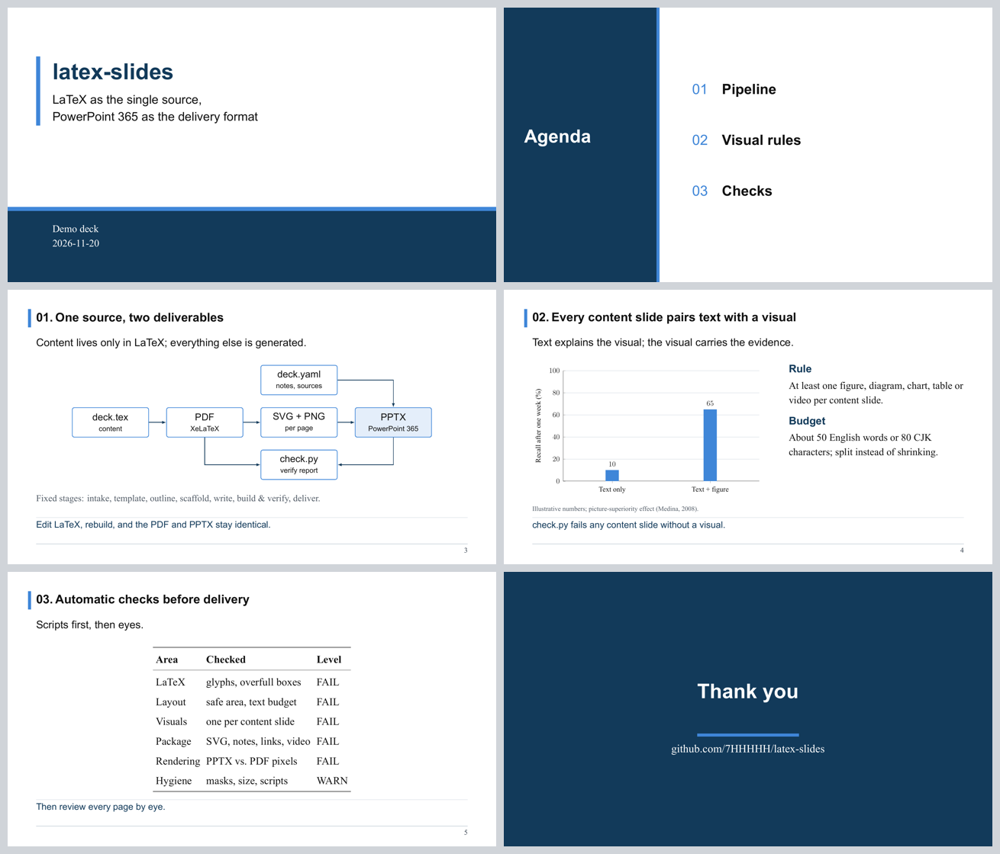

# latex-slides

An agent skill for making presentation decks with **LaTeX/Beamer as the single source of
truth**, delivered as a vector **PDF** and a **PowerPoint 365 PPTX**. In the PPTX, each slide
is an SVG with a PNG fallback, and the file carries speaker notes, embedded video and clickable
links. You can bring your own template (PPTX, PDF or images). The slides can be in any language.



## Why

- **Typesetting quality.** You get LaTeX maths, TikZ/pgfplots figures and precise layout,
  and the PDF and the PPTX look identical.
- **One source.** Content lives in `deck.tex`. Notes, timing and sources live in `deck.yaml`.
  Everything else is generated.
- **A fixed process.** The stages are intake → template → outline → scaffold → write →
  build & verify → deliver, with user checkpoints along the way.
- **Text plus visuals on every slide (图文并茂).** Every content slide needs a figure,
  diagram, chart, table or video, and has a text budget. `check.py` enforces both.
- **Verified output.** Automatic checks cover fonts, overflow, text overlap, the safe area,
  visuals, the PPTX package, links and video, plus a per-page comparison of the rendered
  PPTX against the PDF.

The trade-off: slide text in the PPTX is vector outlines, so you cannot edit it in
PowerPoint. To change a slide, edit the LaTeX and rebuild.

## Install

1. Dependencies: TeX Live (XeLaTeX, latexmk, beamer, pgfplots, textpos, xeCJK),
   poppler-utils, LibreOffice (optional but recommended), and Python ≥ 3.9:
   ```bash
   pip install -r requirements.txt
   python3 scripts/doctor.py
   ```
2. Put this folder where your agent discovers skills. For example:
   - Claude Code: `~/.claude/skills/latex-slides/`
   - Codex: `~/.codex/skills/latex-slides/`
   - Gemini CLI / Antigravity: `~/.gemini/config/skills/latex-slides/` or `<project>/.agents/skills/latex-slides/`

   Any agent that reads `SKILL.md` files works. You can also just point your agent at `SKILL.md`.

## Use it by hand

```bash
# optional: import your template
python3 scripts/import_template.py my_tpl --pptx lab_template.pptx      # then check my_tpl/preview.png
# scaffold
python3 scripts/new_deck.py talks/grpo_20261120 --title "GRPO in Practice" --presenter "Ada" \
    --language en --duration 900 --template my_tpl
# edit talks/grpo_20261120/deck.tex and deck.yaml, then
python3 scripts/build.py talks/grpo_20261120
python3 scripts/check.py talks/grpo_20261120
```

Outputs go to `output/<name>.pptx`, `.pdf` and `.notes.md`. Rebuilds write `_v2`, `_v3`, …
and never overwrite earlier versions.

## Layout

```
SKILL.md                 procedure and rules the agent follows
scripts/                 import_template, new_deck, build, check, doctor
latex/latex-slides.sty   layout macros driven by template.yaml
templates/default/       neutral built-in template
references/              macros, template spec, deck.yaml, troubleshooting
examples/demo/           the deck shown above
tests/                   end-to-end tests (python3 -m unittest discover -s tests)
```

## Compatibility

| Viewer | Result |
|---|---|
| PowerPoint 365 (Windows/macOS) | vector SVG slides, notes, video, links (**supported target**) |
| Keynote, Google Slides | PNG fallback (raise `build.png_width` for sharper slides) |
| LibreOffice Impress | renders; used by `check.py` for comparison |
| WPS / older Office | may render SVG soft masks badly; use `--raster-only` |

## License

MIT. Templates you import may carry their own copyright, so keep them out of public repos.
