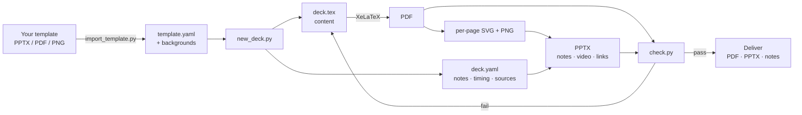

<div align="center">

# 🎞️ latex-slides

**Let your coding agent write slides in LaTeX and deliver them as a pixel-identical PDF and PowerPoint deck.**

English · [简体中文](README.zh-CN.md)

[](LICENSE)
-purple)


</div>

---

## Why

Agents are good at writing LaTeX: equations, TikZ diagrams and pgfplots charts come out
precise and reproducible. But talks are usually given from PowerPoint, and converting
between the two by hand loses layout, fonts and speaker notes. Asking an agent to "make a
PPT" directly tends to produce text-heavy slides with drifting styles and no record of
where the numbers came from.

> **Can one source give a polished PDF *and* a PowerPoint file, follow my template, and be checked before I present it?**

This skill fixes the whole process. Content lives only in LaTeX, notes and sources live in
one YAML file, and scripts build, convert and verify the deck. Each slide in the PPTX is a
vector picture that looks exactly like the PDF page, with your speaker notes attached.

## Features

| | |
|---|---|
| 📝 **One source of truth** | Slide content is in `deck.tex`; speaker script, timing and sources are in `deck.yaml`. PPTX notes and a printable script are generated from them. Nothing is edited twice. |
| 🖼 **Vector PPTX** | Every page becomes an SVG (text as outlines) with a PNG fallback in the same picture, so PowerPoint 365 shows crisp vector slides and other viewers still show the PNG. |
| 🎨 **Bring your own template** | Import a PowerPoint template (layouts, theme colours, theme fonts, placeholder boxes), a PDF, or plain images. A preview with the safe area, title and page-number boxes is generated for you to confirm; colours are sampled from PDF/image backgrounds, and boxes that cover the design are flagged. Two templates are built in: `paper` (warm, serif headings, shown above) and `default` (navy and blue). |
| 🧭 **A fixed seven-stage process** | Intake → template → outline → scaffold → write → build & verify → deliver. The agent stops for your confirmation at intake, template, outline and delivery. |
| 🖌 **Text plus visuals, and real information** | Every content slide must carry a figure, diagram, chart, table or video, plus the numbers and comparisons that explain it. Dense layouts (`lsgrid` with cards, figure rows and headline `\stat`s) fit a visual and its evidence on one slide. `check.py` fails slides without a visual or over the text budget (≈ 90 English words / 150 CJK characters) and warns on near-empty ones. |
| ✅ **Verified before delivery** | 18 automatic checks: missing glyphs, overfull boxes, text outside the safe area, overlapping text, visuals, information density, timing, SVG hygiene, PPTX package integrity, links, video, and a per-page pixel comparison of the rendered PPTX against the PDF. Then the agent reviews every page image. |
| 🧪 **Honest sourcing** | Every number and borrowed figure carries a source (`strict` / `normal` / `off`). Verified results are kept apart from plans and illustrative data. |
| 🎬 **Video and links** | `\lsvideo` puts a clickable poster in the PDF and an embedded movie at the same spot in the PPTX. Hyperlinks stay clickable. |
| 🌐 **Your language** | The skill is written in English; slides and notes follow the language you ask for. CJK fonts and note labels are configured automatically. |
| 🗂 **Never overwrites** | Rebuilds write `name_v2`, `name_v3`, … and a JSON verification report per version. |

## How it works



The agent follows seven stages; ★ marks a stop for your confirmation:

```
1 Intake ★     purpose · audience · duration · language · template · sourcing level
2 Template ★   import, fit the safe area, confirm the preview
3 Outline ★    per slide: claim-style title, key message, planned visual, seconds
4 Scaffold     new_deck.py creates the project
5 Write        deck.tex (layout macros) + deck.yaml (script, sources)
6 Verify       build.py → check.py → page-by-page visual review
7 Deliver ★    versioned PDF / PPTX / notes + verification report
```

## Install

This is a standard [Agent Skill](https://agentskills.io): a folder with a `SKILL.md`.
Clone it once, then link it into each agent's skills directory:

```bash
git clone https://github.com/7HHHHH/latex-slides.git ~/.agents/skills/latex-slides
pip install -r ~/.agents/skills/latex-slides/requirements.txt
python3 ~/.agents/skills/latex-slides/scripts/doctor.py      # reports anything missing
```

| Agent | Command |
|---|---|
| Claude Code | `ln -s ~/.agents/skills/latex-slides ~/.claude/skills/latex-slides` |
| Gemini CLI / Antigravity | `ln -s ~/.agents/skills/latex-slides ~/.gemini/config/skills/latex-slides` |
| Codex CLI | `ln -s ~/.agents/skills/latex-slides ~/.codex/skills/latex-slides` |
| Project-only | copy the folder to `<repo>/.agents/skills/` (or `<repo>/.claude/skills/`) |

> [!TIP]
> Some agents don't support skills natively. For those, add one line to `AGENTS.md`:
> *"When making slides, follow `~/.agents/skills/latex-slides/SKILL.md`."*

### Requirements

| Component | Used for |
|---|---|
| TeX Live / MacTeX / MiKTeX with XeLaTeX, latexmk, beamer, pgfplots, textpos, xeCJK | compiling the deck |
| poppler-utils (`pdftoppm`, `pdftocairo`, `pdftotext`, `pdfseparate`) | SVG/PNG export, layout checks |
| LibreOffice *(recommended)* | importing PPTX templates, rendering the PPTX for comparison |
| Python ≥ 3.9 with `python-pptx`, `lxml`, `PyYAML`, `pypdf`, `Pillow`, `numpy` | building and checking the PPTX |

## Usage

Just ask, in any language:

```text
Make a 15-minute group-meeting deck from this paper, using my lab template lab.pptx.
Turn these results into 10 slides for Friday, in English.
用我们组的模板做一份组会汇报，15 分钟。
```

The agent asks what it cannot infer, shows you the template preview and the outline, then
builds and verifies the deck. You get:

```
output/<name>.pptx        PowerPoint 365 deck with speaker notes (and videos)
output/<name>.pdf         the same slides as a vector PDF
output/<name>.notes.md    printable speaker script
verify/<name>.json        check results and visual-review notes
```

To change anything, ask the agent (or edit `deck.tex` / `deck.yaml` yourself) and rebuild:

```bash
python3 scripts/build.py talks/my_talk      # → output/<name>_v2.pptx
python3 scripts/check.py talks/my_talk
```

## What's inside

```
SKILL.md                     instructions the agent follows (stages, rules)
scripts/import_template.py   PPTX / PDF / images → template.yaml + backgrounds + preview
scripts/new_deck.py          scaffold a deck project
scripts/build.py             deck.tex → PDF → SVG + PNG → PPTX (notes, links, video)
scripts/check.py             automatic verification → verify/<version>.json
scripts/doctor.py            dependency check
latex/latex-slides.sty       layout macros driven by template.yaml
templates/paper/             built-in template: warm paper, indigo and terracotta
templates/default/           built-in template: white, navy and blue
references/                  macros, template spec, deck.yaml, troubleshooting
examples/demo/               the deck shown above
tests/                       end-to-end tests
```

## Macros at a glance

Coordinates are in bp from the top-left corner (default page 960 × 540).

| You want… | Macro |
|---|---|
| A one-sentence question at the top | `\lead{...}` |
| Picture left, text right (or the reverse) | `\splitpic[ratio]{file}{caption}{text}` · `\textpic` |
| A block or image at an exact position | `\at{x}{y}{w}{...}` · `\pic{x}{y}{w}{h}{file}` · `\figat` |
| A heading with a paragraph | `\point{heading}{text}` |
| The conclusion at the bottom | `\takeaway{...}` |
| An embedded video | `\lsvideo{x}{y}{w}{poster}{media/clip.mp4}` |
| Cover, agenda, section or closing page | `{\lsrole{cover} \begin{frame}[plain] ... \end{frame}}` |

```latex
\begin{frame}{Group-relative advantages remove the value model}\slideid{grpo}
\lead{How does GRPO score a response without a critic?}
\splitpic[0.6]{grpo.png}{Figure: Shao et al. 2024, Fig. 4.}{%
  \point{Sample}{$G$ answers per prompt.}\vspace{10pt}
  \point{Normalise}{Reward minus group mean, divided by std.}}
\takeaway{The learning signal comes from differences inside the group.}
\end{frame}
```

See [`references/macros.md`](references/macros.md) for the full list.

## Verify a deck

```bash
python3 scripts/check.py examples/demo
```

```text
PASS  latex.missing_glyphs
PASS  latex.overfull_boxes
PASS  layout.text_inside_safe_area
PASS  layout.text_overlap
PASS  visual.text_budget
PASS  visual.every_content_slide_has_visual
PASS  pptx.integrity
PASS  render.pptx_vs_pdf
...
report: examples/demo/verify/latex-slides_demo.json
```

Failures stop delivery; warnings (missing scripts, SVG masks, large files) are reported to
you. The full list is in [`references/deck-yaml.md`](references/deck-yaml.md#checkpy).

## Compatibility

| Viewer | Result |
|---|---|
| PowerPoint 365 (Windows / macOS) | Vector SVG slides, notes, embedded video, links — **supported target** |
| Keynote, Google Slides | PNG fallback (raise `build.png_width` for sharper slides) |
| LibreOffice Impress | Renders correctly; used by `check.py` for the pixel comparison |
| WPS, older Office | May draw SVG soft masks badly; rebuild with `--raster-only` |

## FAQ

<details>
<summary><b>Can I edit the slides in PowerPoint?</b></summary>

Not the text: slides are vector pictures so they look exactly like the PDF on every
machine, with no font substitution. Edit `deck.tex` and rebuild instead; it takes seconds.
PowerPoint's "Convert to Shape" works for small graphical touch-ups.
</details>

<details>
<summary><b>Why not generate PPTX shapes directly?</b></summary>

Native shapes reflow differently across PowerPoint, Keynote and WPS, and cannot express
LaTeX maths, TikZ or pgfplots. Rendering from LaTeX keeps one layout everywhere and lets the
PDF and PPTX be checked against each other.
</details>

<details>
<summary><b>Which templates work?</b></summary>

Any PowerPoint template whose design lives in slide layouts (`--pptx`), templates whose
design lives on sample slides (`--pptx --mode slides`), multi-page PDFs (`--pdf --map`), or
one image per page type. The importer writes `template.yaml`; adjust the boxes until the
preview matches. See [`references/template-spec.md`](references/template-spec.md).
</details>

<details>
<summary><b>Does it work for languages other than English?</b></summary>

Yes. Set the deck language (for example `zh-CN`, `ja`, `de`); CJK languages load xeCJK and
CJK fonts automatically, with free fallbacks such as Noto CJK. Right-to-left scripts are not
supported yet.
</details>

<details>
<summary><b>What about overlays like <code>\pause</code>?</b></summary>

Each overlay step becomes its own slide in the PPTX (PowerPoint animations are not
generated). The speaker notes go on the first step.
</details>

## Contributing

Issues and PRs are welcome, especially more layout helpers, template importers and viewer
compatibility fixes. Please run the tests before submitting:

```bash
python3 -m unittest discover -s tests
```

## License

[MIT](LICENSE). Templates you import may carry their own copyright; keep them out of public repositories.
