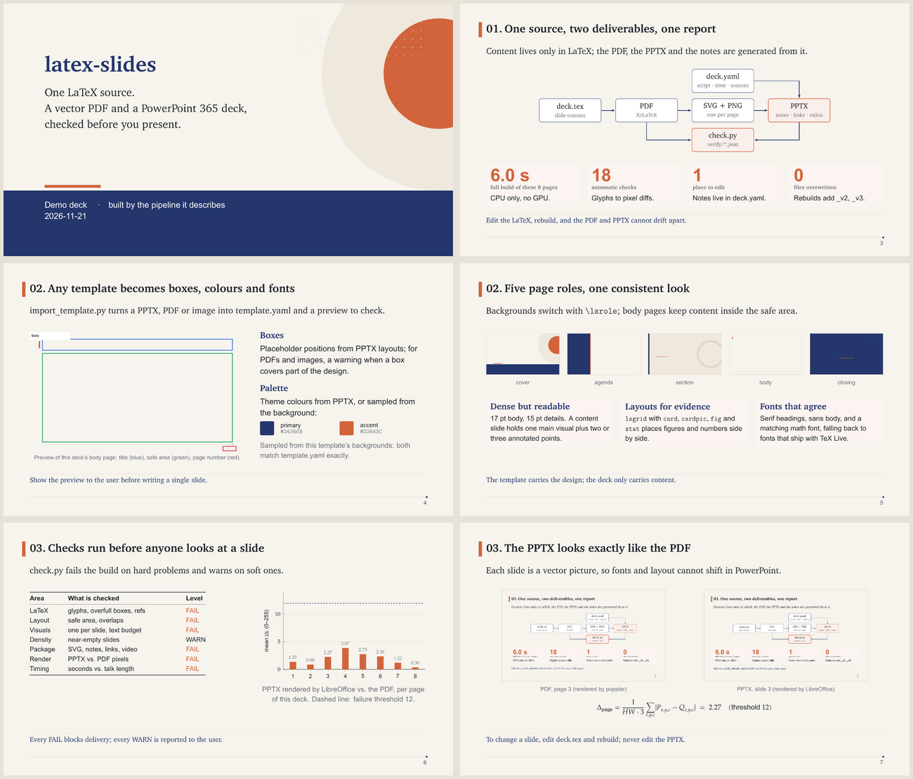
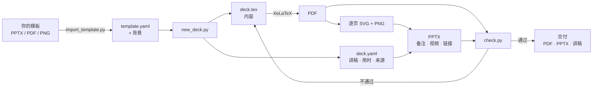

<div align="center">

# 🎞️ latex-slides

**让 coding agent 用 LaTeX 写幻灯片，同时交付像素级一致的 PDF 和 PowerPoint。**

[English](README.md) · 简体中文

[](LICENSE)
-purple)




</div>

---

## 为什么

agent 很擅长写 LaTeX，公式、TikZ 流程图、pgfplots 图表都精确、可复现。但汇报通常用
PowerPoint，两者之间手动转换会丢掉版式、字体和讲者备注。直接让 agent "做个 PPT"，
又常常得到满屏文字、风格不统一、数字说不清出处的幻灯片。

> **能不能一份源文件，同时得到漂亮的 PDF 和 PowerPoint，套用我的模板，并且在上台前检查过？**

这个 skill 把整个流程固定下来：内容只写在 LaTeX 里，讲稿和来源只写在一个 YAML 文件里，
构建、转换和检查都交给脚本。PPTX 里每页都是和 PDF 完全一致的矢量图，并带上讲者备注。

## 特性

| | |
|---|---|
| 📝 **唯一真源** | 幻灯片内容在 `deck.tex`，讲稿、用时和来源在 `deck.yaml`。PPTX 备注和可打印讲稿都由它们生成，任何内容都不用改两遍 |
| 🖼 **矢量 PPTX** | 每页导出为 SVG（文字转曲线），同一张图片里附带 PNG 备用图。PowerPoint 365 显示清晰的矢量页面，其他软件显示 PNG |
| 🎨 **使用你自己的模板** | 可导入 PowerPoint 模板（版式、主题色、主题字体、占位符位置）、PDF 或图片。会生成标出安全区、标题框和页码框的预览图供你确认；PDF/图片模板会自动提取配色，标题框或安全区压到背景装饰时会提醒。内置两套模板：`paper`（暖色、衬线标题，即上图）和 `default`（藏青与蓝） |
| 🧭 **固定的七个阶段** | 需求确认 → 模板 → 大纲 → 建工程 → 写作 → 构建与检查 → 交付。需求、模板、大纲和交付四个节点会停下来等你确认 |
| 🖌 **图文并茂、信息量足** | 每张内容页必须有图片、示意图、图表、表格或视频，并配上解释它的关键数字和对比。高密度版式（`lsgrid` 卡片、多图并排、`\stat` 大数字）能把一张图和它的证据放在同一页。没有图或正文超出上限（约 150 个汉字或 90 个英文单词）时 `check.py` 报错，几乎没有解释的空页会给出提醒 |
| ✅ **交付前自动检查** | 18 项检查：缺字、Overfull、文字越出安全区、文字重叠、是否有图、信息量、总时长、SVG 规范、PPTX 包完整性、链接、视频，以及把 PPTX 渲染出来与 PDF 逐页比对像素。之后 agent 还会逐页看图检查 |
| 🧪 **如实标注来源** | 每个数字和引用的图都要有出处（`strict` / `normal` / `off` 三档）。已验证的结果与计划、示意数据分开标注 |
| 🎬 **视频和链接** | `\lsvideo` 在 PDF 里生成可点击的封面图，在 PPTX 同一位置嵌入视频；超链接在 PPTX 里仍可点击 |
| 🌐 **跟随你的语言** | skill 本身用英文写，幻灯片和讲稿用你要求的语言。中日韩字体和备注标签自动配置 |
| 🗂 **从不覆盖** | 重新构建会生成 `name_v2`、`name_v3`……，每个版本都有一份 JSON 检查报告 |

## 工作原理



agent 按七个阶段执行，★ 表示停下来等你确认：

```
1 需求确认 ★   用途 · 听众 · 时长 · 语言 · 模板 · 来源要求
2 模板 ★       导入模板，调整安全区，确认预览图
3 大纲 ★       每页：结论式标题、核心信息、计划用的图、用时
4 建工程       new_deck.py 生成工程目录
5 写作         deck.tex（排版宏）+ deck.yaml（讲稿、来源）
6 检查         build.py → check.py → 逐页看图检查
7 交付 ★       带版本号的 PDF / PPTX / 讲稿 + 检查报告
```

## 安装

这是一个标准的 [Agent Skill](https://agentskills.io)，也就是一个包含 `SKILL.md` 的文件夹。
先 clone 一次，再软链接到各个 agent 的 skills 目录：

```bash
git clone https://github.com/7HHHHH/latex-slides.git ~/.agents/skills/latex-slides
pip install -r ~/.agents/skills/latex-slides/requirements.txt
python3 ~/.agents/skills/latex-slides/scripts/doctor.py      # 列出缺少的依赖
```

| Agent | 命令 |
|---|---|
| Claude Code | `ln -s ~/.agents/skills/latex-slides ~/.claude/skills/latex-slides` |
| Gemini CLI / Antigravity | `ln -s ~/.agents/skills/latex-slides ~/.gemini/config/skills/latex-slides` |
| Codex CLI | `ln -s ~/.agents/skills/latex-slides ~/.codex/skills/latex-slides` |
| 只给某个项目用 | 把文件夹复制到 `<repo>/.agents/skills/`（或 `<repo>/.claude/skills/`） |

> [!TIP]
> 有些 agent 不直接支持 skill。对它们，在 `AGENTS.md` 里加一句即可：
> *"做幻灯片时，按照 `~/.agents/skills/latex-slides/SKILL.md` 执行。"*

### 依赖

| 组件 | 用途 |
|---|---|
| TeX Live / MacTeX / MiKTeX，含 XeLaTeX、latexmk、beamer、pgfplots、textpos、xeCJK | 编译幻灯片 |
| poppler-utils（`pdftoppm`、`pdftocairo`、`pdftotext`、`pdfseparate`） | 导出 SVG/PNG、版面检查 |
| LibreOffice（推荐） | 导入 PPTX 模板、渲染 PPTX 做比对 |
| Python ≥ 3.9，含 `python-pptx`、`lxml`、`PyYAML`、`pypdf`、`Pillow`、`numpy` | 生成和检查 PPTX |

## 使用

直接说就行，用什么语言都可以：

```text
用我们组的模板 lab.pptx，根据这篇论文做一份 15 分钟的组会汇报。
把这些实验结果做成 10 页幻灯片，周五用，英文。
Make a 15-minute group-meeting deck from this paper.
```

agent 会先问清楚无法推断的信息，给你看模板预览和大纲，再构建并检查。最终得到：

```
output/<name>.pptx        带讲者备注（和视频）的 PowerPoint 365 文件
output/<name>.pdf         同样内容的矢量 PDF
output/<name>.notes.md    可打印的讲稿
verify/<name>.json        检查结果和看图检查记录
```

需要修改时，告诉 agent（或自己改 `deck.tex` / `deck.yaml`），然后重新构建：

```bash
python3 scripts/build.py talks/my_talk      # → output/<name>_v2.pptx
python3 scripts/check.py talks/my_talk
```

## 目录结构

```
SKILL.md                     agent 执行的流程和规则
scripts/import_template.py   PPTX / PDF / 图片 → template.yaml + 背景 + 预览图
scripts/new_deck.py          新建幻灯片工程
scripts/build.py             deck.tex → PDF → SVG + PNG → PPTX（备注、链接、视频）
scripts/check.py             自动检查 → verify/<版本>.json
scripts/doctor.py            依赖检测
latex/latex-slides.sty       由 template.yaml 驱动的排版宏
templates/paper/             内置模板：暖色纸张底、靛蓝与陶土橙
templates/default/           内置模板：白底、藏青与蓝
references/                  宏说明、模板规范、deck.yaml、常见问题
examples/demo/               上图所示的示例
tests/                       端到端测试
```

## 常用宏

坐标单位是 bp，从页面左上角算起（默认页面 960 × 540）。

| 想要…… | 宏 |
|---|---|
| 页面顶部一句话引出问题 | `\lead{...}` |
| 左图右文（或左文右图） | `\splitpic[比例]{图}{图注}{文字}` · `\textpic` |
| 在指定位置放文字或图片 | `\at{x}{y}{w}{...}` · `\pic{x}{y}{w}{h}{图}` · `\figat` |
| 小标题加一段说明 | `\point{标题}{正文}` |
| 页面底部的结论 | `\takeaway{...}` |
| 嵌入视频 | `\lsvideo{x}{y}{w}{封面图}{media/clip.mp4}` |
| 封面、目录、章节页、结束页 | `{\lsrole{cover} \begin{frame}[plain] ... \end{frame}}` |

```latex
\begin{frame}{组内相对优势省去了价值模型}\slideid{grpo}
\lead{没有价值模型，GRPO 如何给回答打分？}
\splitpic[0.6]{grpo.png}{图：Shao et al. 2024，Figure 4。}{%
  \point{采样}{每个问题生成 $G$ 条回答。}\vspace{10pt}
  \point{归一化}{回报减去组内均值，再除以标准差。}}
\takeaway{学习信号来自同一组回答之间的差异。}
\end{frame}
```

完整列表见 [`references/macros.md`](references/macros.md)。

## 检查幻灯片

```bash
python3 scripts/check.py examples/demo
```

```text
PASS  latex.missing_glyphs
PASS  latex.overfull_boxes
PASS  layout.text_inside_safe_area
PASS  layout.text_overlap
PASS  visual.text_budget
PASS  visual.every_content_slide_has_visual
PASS  pptx.integrity
PASS  render.pptx_vs_pdf
...
report: examples/demo/verify/latex-slides_demo.json
```

出现 FAIL 就不能交付；WARN（缺讲稿、SVG 蒙版、文件过大等）会报告给你。
完整检查项见 [`references/deck-yaml.md`](references/deck-yaml.md#checkpy)。

## 兼容性

| 软件 | 效果 |
|---|---|
| PowerPoint 365（Windows / macOS） | 矢量 SVG 页面、备注、嵌入视频、链接，**主要支持对象** |
| Keynote、Google Slides | 显示 PNG 备用图（调高 `build.png_width` 可更清晰） |
| LibreOffice Impress | 显示正常；`check.py` 用它做像素比对 |
| WPS、旧版 Office | SVG 透明蒙版可能显示异常，可用 `--raster-only` 重新构建 |

## 常见问题

<details>
<summary><b>能在 PowerPoint 里改字吗？</b></summary>

不能直接改文字。页面是矢量图，所以在任何电脑上都和 PDF 一模一样，不会出现字体替换。
请修改 `deck.tex` 后重新构建，只需几秒。小的图形调整可以用 PowerPoint 的"转换为形状"。
</details>

<details>
<summary><b>为什么不直接生成 PowerPoint 原生形状？</b></summary>

原生形状在 PowerPoint、Keynote、WPS 里排版各不相同，也无法表达 LaTeX 公式、TikZ 和
pgfplots。从 LaTeX 渲染能保证处处一致，还能让 PDF 和 PPTX 互相比对检查。
</details>

<details>
<summary><b>支持哪些模板？</b></summary>

设计放在版式里的 PowerPoint 模板（`--pptx`）、设计放在示例页上的模板
（`--pptx --mode slides`）、多页 PDF（`--pdf --map`），或者每种页面一张图片。
导入后会生成 `template.yaml`，按预览图调整到位即可。详见
[`references/template-spec.md`](references/template-spec.md)。
</details>

<details>
<summary><b>支持中文和其他语言吗？</b></summary>

支持。设置 deck 语言（如 `zh-CN`、`ja`、`de`）即可；中日韩语言会自动加载 xeCJK 和对应字体，
并回退到 Noto CJK 等免费字体。暂不支持阿拉伯文等从右向左书写的语言。
</details>

<details>
<summary><b><code>\pause</code> 这类逐步显示怎么处理？</b></summary>

每一步在 PPTX 里都是单独一张幻灯片，不生成 PowerPoint 动画。讲者备注放在第一步。
</details>

## 参与贡献

欢迎提 Issue 和 PR，特别是新的排版辅助宏、模板导入方式和各软件的兼容性修复。提交前请运行测试：

```bash
python3 -m unittest discover -s tests
```

## 许可证

[MIT](LICENSE)。你导入的模板可能有自己的版权，请不要把它们放进公开仓库。
